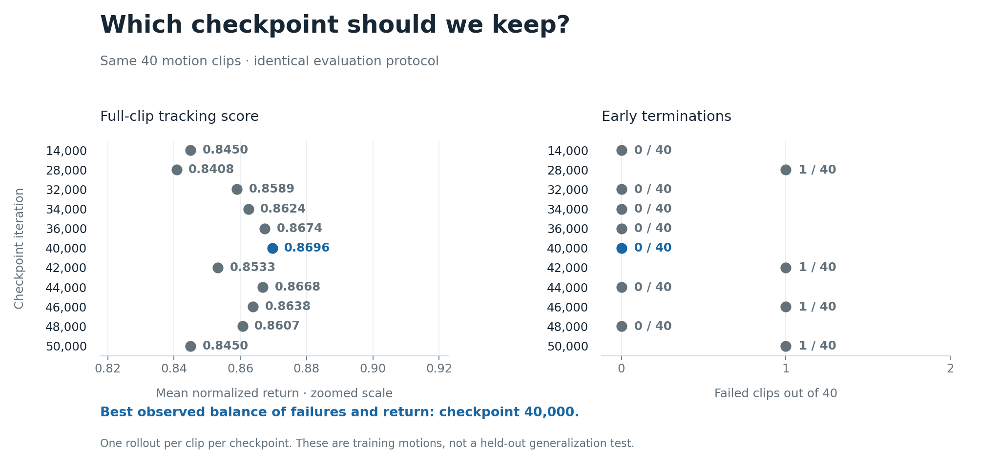

# G1 LAFAN1 policy release

This fork's laptop run produced checkpoint **40,000**, the strongest of **11** evaluated checkpoints:

| Checkpoint | Mean normalized return | Failed clips |
|---|---:|---:|
| 14,000 | 0.8450 | 0 / 40 |
| **40,000** | **0.8696** | **0 / 40** |
| 50,000 | 0.8450 | 1 / 40 |



[Scores](media/checkpoint_summary.csv) · [Selected checkpoint and per-clip results](media/evaluation_040000.json)

- One deterministic rollout per training clip, from its first frame to completion or termination.
- Nominal friction 1.0, no observation/action noise or domain randomization during evaluation.
- Return divides accumulated reward by the complete clip's maximum reward. It is not position accuracy.
- Failure checks pelvis-height error above 0.25 m or a dimensionless vertical-orientation mismatch above 0.8.
- Familiar-motion coverage, not unseen-motion generalization. No physical Aletta validation. Self-collisions are disabled.

## Publication status

The inference package and motion previews are being prepared for Hugging Face. Public redistribution of the LAFAN1-derived weights and rendered reference motions needs a resolved basis first. See [licensing review](RELEASE_LICENSES.md). The code and numerical evaluation results can be reviewed independently.

## Use the compact policy

Use the existing [Docker and asset setup](../README.md#setup). The release does not include motion CSVs, robot meshes or simulator assets. Obtain those from their sources and follow their terms.

The loader accepts an original `.pt` checkpoint, a `policy.safetensors` file or its containing directory. Existing commands remain valid:

```bash
docker exec supermimic python supermimic/evaluate.py \
  --run_dir logs/released_policy \
  --ckpt checkpoints/g1-lafan1-040000
```

Once a model repository is published, download its pinned tag or exact Hub commit using:

```bash
python3 -m pip install 'huggingface_hub>=0.33.4,<2'
python3 tools/download_policy.py OWNER/MODEL \
  --revision RELEASE_TAG_OR_COMMIT \
  --output checkpoints/g1-lafan1-040000
```

`OWNER/MODEL` and the revision must identify an actual published release. This page does not claim public weights are already available. The downloader verifies policy/config SHA-256 hashes. A trusted pinned Hub revision establishes which manifest you intended to download.

The artifact includes the motion encoder, action decoder and normalization buffers. It excludes the world model, critic, optimizer and replay buffer. **Inference only, not a training-resume checkpoint.**

The policy expects 10 observation frames of 99 values and 10 future reference frames of 73 values each. It outputs 29 normalized actions, converted to joint-position targets using the existing per-joint actuator scales and offsets. Joint order and runtime metadata are recorded in `config.json`. Do not send these actions directly to robot motors.

## Export and verify locally

Run inside the installed simulator runtime, which provides PyTorch and safetensors:

```bash
python tools/export_policy.py logs/lafan1_pilot/ckpt_040000.pt \
  /absolute/path/to/NEW_release_directory
python tools/verify_policy_release.py logs/lafan1_pilot/ckpt_040000.pt \
  /absolute/path/to/NEW_release_directory \
  --motion data/lafan1_g1/walk1_subject1.csv
python -m unittest tools.test_policy_release
```

Verification compares every policy tensor and normalization buffer, checks hashes and compares actions on zero, normalization-scaled and optional real reference-state inputs. It uses CPU and CUDA when available. This checks serialization and inference, not a new full-clip performance benchmark.

## Credits

- **Method:** Qiayuan Liao and colleagues, [SuperMimic](https://supermimic.github.io/), [paper](https://arxiv.org/abs/2610.28480).
- **Independent implementation:** Chong Zhang, ETH Zurich, [supermimic_vibed](https://github.com/zita-ch/supermimic_vibed). Original MIT notice remains in [LICENSE](../LICENSE).
- **This fork/run:** Pantelis Manouselis. Laptop training, checkpoint evaluation, asset-cache fix, analysis and release packaging. This is not an official authors' checkpoint.
- **Motion source:** Ubisoft La Forge, [LAFAN1](https://github.com/ubisoft/ubisoft-laforge-animation-dataset), *Robust Motion In-betweening*, Harvey et al., 2020.
- **Retargeting:** [lvhaidong/Unitree G1 retargets](https://huggingface.co/datasets/lvhaidong/LAFAN1_Retargeting_Dataset).
- **Runtime:** Isaac Lab, Newton and MuJoCo-Warp. See the setup instructions for the pinned Isaac Lab revision.

The original README's RTX PRO 6000 results belong to the upstream reproduction. The laptop results above are separate.
